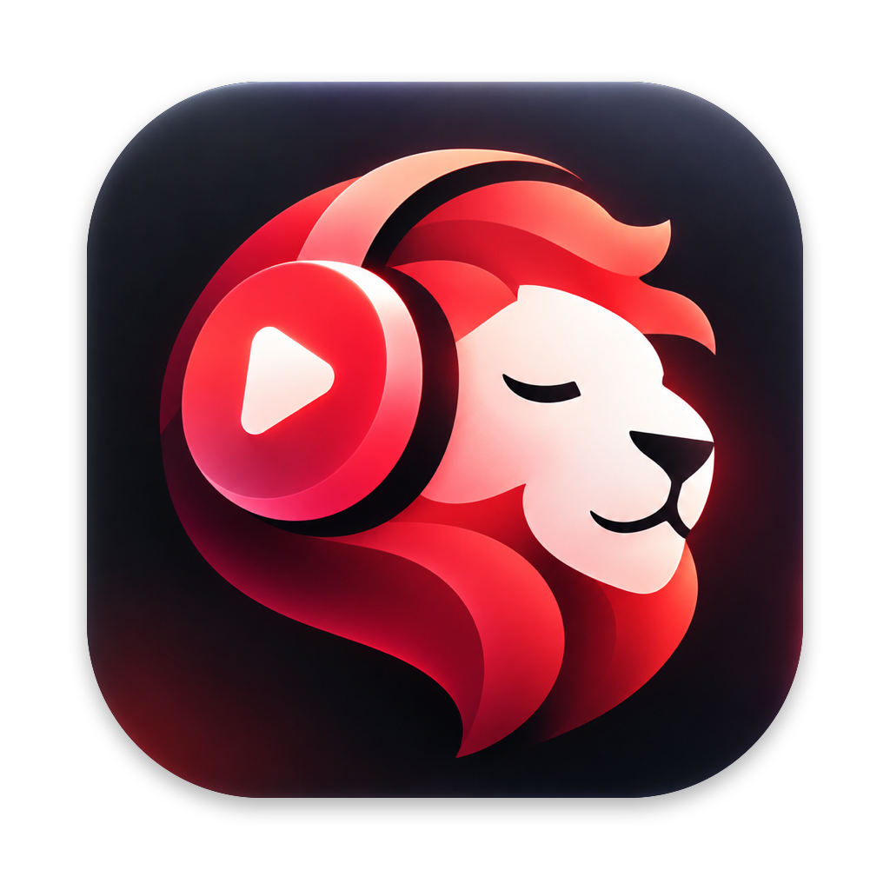
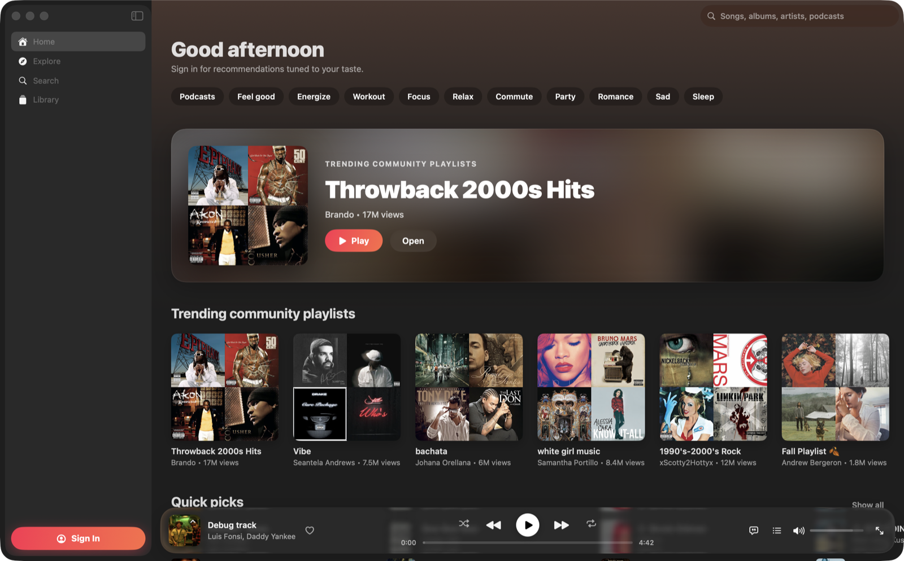

<p align="center">
  
</p>

<h1 align="center">LeoTube</h1>

<p align="center">
  A native macOS client for YouTube Music, built with SwiftUI and Liquid Glass.
  <br><br>
  <a href="https://github.com/9tong/leotube/releases/latest"><b>Download</b></a> ·
  <a href="https://github.com/9tong/leotube/actions/workflows/build.yml"></a>
</p>



## Why another YouTube Music app?

This is an easy time to build something. I tried a lot of the open-source YouTube Music apps for the Mac, and most of them either wrap the website in a window or still feel like the old YouTube Music interface. I wanted something that feels like it belongs on macOS 26 and is as pleasant to use as the best music players, so I made a new one.

LeoTube is native from the ground up. Every screen is built in SwiftUI with Liquid Glass. Signing in uses your own Google account, so your recommendations, library, likes and YouTube Premium benefits all carry over.

## Features

- **Home:** your personal recommendations ("Listen again", "Albums for you", "Mixed for you", Quick picks), with mood filters and a featured card.
- **Explore:** new releases, charts, moods and genres, and podcasts.
- **Library:** playlists, songs, albums, artists, podcasts and history. Liked Music and your playlists are in the sidebar.
- **Search:** suggestions as you type, a top result shown next to matching songs, results grouped by type, and filters.
- **Pages:** album and playlist pages tinted with the artwork's colours, and artist pages with a parallax banner.
- **Player:** a floating Liquid Glass player bar, a queue pop-up, lyrics, related tracks, and a full-screen Now Playing view. Shuffle, repeat, radio and autoplay are included.
- **Your account:** like songs, save albums and playlists, follow artists, and create or edit playlists.
- **Mac integration:** media keys, Control Center Now Playing, Space to play/pause, keyboard shortcuts, and your queue is restored on relaunch.

## Install

1. Download the latest `LeoTube-x.y.z.dmg` from [Releases](https://github.com/9tong/leotube/releases/latest).
2. Open it and drag **LeoTube** into **Applications**.
3. The app is not notarized by Apple, so the first launch shows a warning. Right-click the app and choose **Open**, or run `xattr -dr com.apple.quarantine /Applications/LeoTube.app`.

LeoTube requires macOS 26 (Tahoe) or later.

## Build from source

You only need Xcode or the Command Line Tools with the macOS 26 SDK. The app builds with Swift Package Manager.

```bash
scripts/build-app.sh          # release build → build/LeoTube.app
open build/LeoTube.app
scripts/make-dmg.sh           # → build/LeoTube-<version>.dmg
```

`scripts/build-app.sh debug` makes a debug build. The version number comes from `CFBundleShortVersionString` in `Resources/Info.plist`.

Every push to `main` builds the DMG on GitHub Actions, and you can download it from that run's artifacts. Pushing a `v*` tag publishes a GitHub Release with the DMG attached.

### App icon

| File | Purpose |
|---|---|
| `Resources/AppIcon-source.png` | The original artwork. |
| `Resources/AppIcon.png` | A 1024×1024 icon with a transparent background, fitted to the macOS icon grid. |
| `Resources/AppIcon.icns` | Generated from `AppIcon.png` during the build. |

To use new artwork, replace the source file and run:

```bash
swift scripts/prepare-icon.swift Resources/AppIcon-source.png Resources/AppIcon.png
```

## How it works

| Layer | What it does |
|---|---|
| `Sources/YTMusicKit` | Client and parsers for YouTube Music's internal API (InnerTube, the `WEB_REMIX` client). Every card or row becomes a `MediaItem` and every section a `Shelf`, so Home, Explore, artists, moods, library and search all share one set of views. |
| `PlayerEngine` | A hidden `WKWebView` running the official YouTube Music web player, controlled through a small JavaScript bridge. YouTube handles stream signing, quality and Premium (no ads), and the native app owns the queue. |
| `PlaybackController` | Queue, shuffle and repeat, radio continuation, autoplay, lyrics, likes and session restore. Now Playing and media keys go through `NowPlayingCenter`. |
| `AuthManager` | You sign in on Google's own sign-in page. The cookies stay in macOS's WebKit storage on your Mac, which the player also uses, and API calls are signed with `SAPISIDHASH`. |

## Developer tools

| Tool | What it does |
|---|---|
| `swift run ytm-probe [home\|explore\|search <q>\|browse <id>\|next <videoId>]` | Runs the parsers against the live API. |
| `LEOTUBE_DEBUG=1` | Logs the player engine's state. |
| `LEOTUBE_DEBUG_TOUR=<dir>` | Walks through the main screens and saves a real window capture of each, Liquid Glass included. If you're signed in, it runs a real search on your account unless you also set `LEOTUBE_EPHEMERAL`. |
| `LEOTUBE_DEBUG_TOUR_SIZE=<w>x<h>` | Window size for the tour, e.g. `730x900` to check Split View layouts. |
| `LEOTUBE_EPHEMERAL=1` | Uses a throwaway signed-out session, so development runs never touch your real account. |
| `LEOTUBE_DEBUG_PLAY=<videoId>` | Starts playback at launch. |

## Notes

- If you're not signed in, YouTube may show "Sign in to confirm you're not a bot" and refuse to play. LeoTube retries once with a fresh anonymous session, then asks you to sign in.
- Your account stays on your Mac. LeoTube talks only to Google and YouTube, and has no server of its own.

## Thanks

LeoTube stands on the shoulders of these projects. Thank you to their authors and contributors:

- [Kaset](https://github.com/sozercan/kaset) by @sozercan, a native SwiftUI YouTube Music client for macOS. It shows how good a native client can feel.
- [YT Music](https://github.com/steve228uk/YouTube-Music) by @steve228uk, the original Mac wrapper for YouTube Music, with media keys and Now Playing.
- [ytmusicapi](https://github.com/sigma67/ytmusicapi) by @sigma67, the definitive unofficial YouTube Music API. Its documentation of the InnerTube format and the `SAPISIDHASH` authentication was invaluable.
- [YouTube Music Desktop](https://github.com/th-ch/youtube-music) by @th-ch, the popular cross-platform desktop app with plugins.
- [YTubic](https://github.com/NUber-dev/YTubic) by @NUber-dev, a fast, native-feeling YouTube Music desktop client.

## License

LeoTube is released under the [MIT License](LICENSE).

LeoTube is not affiliated with, endorsed by, or connected to Google or YouTube. YouTube Music is a trademark of Google LLC.
